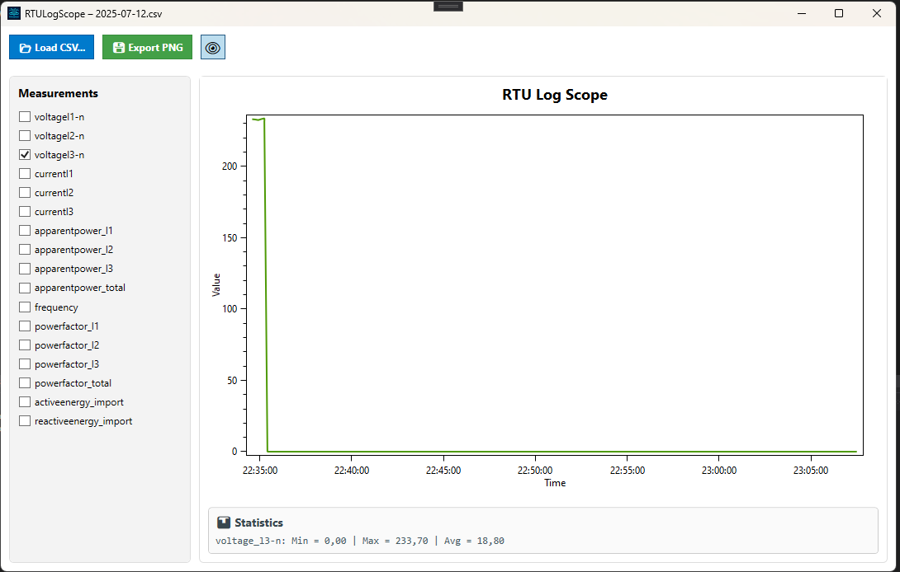
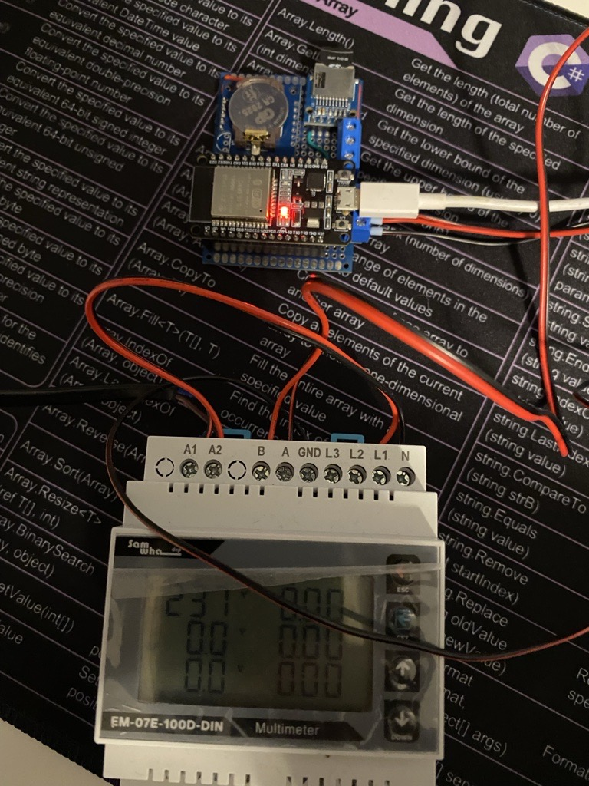
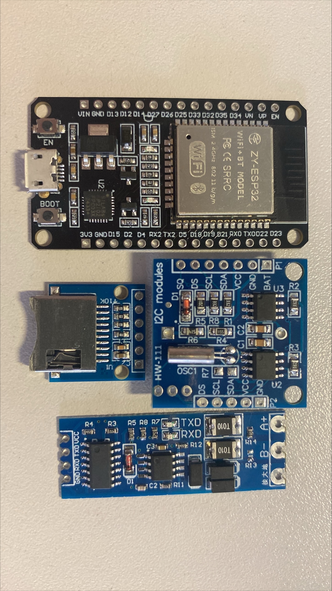

# RTULogSuite

**RTULogSuite** is a complete suite for **logging and visualizing Modbus RTU data**.  
It combines firmware for an ESP32-based Modbus RTU logger with a Windows desktop application for offline CSV visualization.

---

## 📦 What's Included

### 1. 🧠 RTULogScope (WPF Desktop App)
A portable .NET Framework 4.8 Windows application that loads `.csv` logs and displays measurements using interactive charts.

Key Features:
- Load one or multiple CSV files
- Select individual measurements to visualize
- Zoomable & pannable plot (OxyPlot)
- Auto-generated min/max/avg statistics
- Export graph to PNG
- 100% portable – no installation required



📂 App folder: [`/RTULogScope`](RTULogScope/README.md)

---

### 2. 🔌 ESP32Logger (Firmware)
Firmware for the ESP32 microcontroller that:
- Polls Modbus RTU registers via RS485
- Logs values with timestamp to SD card
- Uses RTC (e.g. DS3231) for accurate timing
- Outputs data in `.csv` format for use with RTULogScope

📂 Firmware folder: [`/ESP32Logger`](ESP32Logger/README.md)

---




## 🧭 Repository Structure

```
RTULogSuite/
├── RTULogScope/       # WPF desktop app
│   └── README.md
├── ESP32Logger/       # ESP32 firmware code
│   └── README.md
├── LICENSE
└── README.md          # ← you are here
```

---

## 🔓 License

This project is licensed under the **MIT License**.  
See [`LICENSE`](LICENSE) for details.

---

## ✨ Author

For feedback or contributions, please open an issue or pull request.


## Slovenský sprievodca pre začiatočníkov

V priečinku [docs](docs/00-obsah-a-ako-projekt-tecie.md) nájdeš postupné vysvetlenie štruktúry projektu, ESP32 firmvéru, Modbus komunikácie, ukladania dát a desktopovej aplikácie. Výklad je písaný pre začínajúceho programátora a obsahuje príklady aj upozornenia na rozdiely medzi dokumentáciou a aktuálnym kódom.

